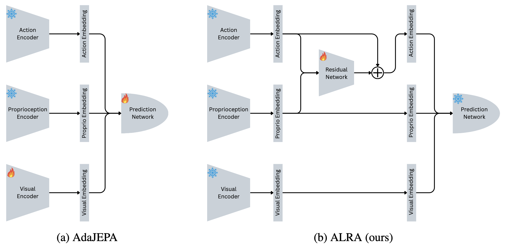
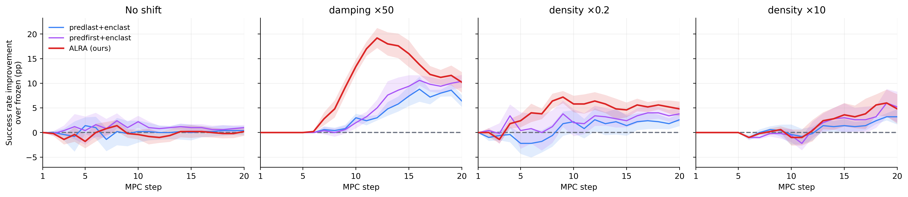

# ALRA: Action-Latent Residual Adaptation for World Models

<p align="center">
  <a href="https://alra-neurips.github.io/"><b>Project page</b></a> &middot;
  <a href="https://openreview.net/forum?id=r5DF75OXlT"><b>Paper</b></a>
</p>

ALRA adapts a pretrained latent world model to dynamics shifts at test time **without updating the model itself**.
The visual, proprioceptive and action encoders and the predictor stay frozen; the only thing trained online is a
zero-initialized affine residual on the action embedding (210 parameters). On PointMaze-Medium it matches the
strongest [AdaJEPA](https://agenticlearning.ai/adajepa/) baseline, which fine-tunes ~10<sup>7</sup> parameters,
under all three dynamics shifts.



See the [project page](https://alra-neurips.github.io/) for rollout videos and more details.

## Code

This repository is the [AdaJEPA codebase](https://github.com/agentic-learning-ai-lab/adajepa) with ALRA added. All other code is unchanged.

| File | Change |
|---|---|
| `planning/residual_adapt.py` | **ALRA**: the action residual and its trainer |
| `planning/adajepa_mpc.py` | `planner.adapt.mode`: `layer` (AdaJEPA) or `residual` (ALRA) |
| `planning/adajepa.py` | `planner.adapt.predictor_block=first` for the `predfirst+enclast` baseline |
| `conf/adajepa_plan_cem_maze.yaml` | the two options above |
| `plan.py` | start/goal pairs strictly more than 3 cells apart; `weights_only=False` checkpoint loading |
| `results.py` | reproduces the paper's tables from `logs/` |
| `logs/` | the 80 evaluation runs reported in the paper |

## Setup

```bash
conda env create -f environment.yaml
conda activate ts
```

Download the AdaJEPA [checkpoints](https://drive.google.com/drive/folders/11IVDIrVDU6W47txR_ku1RkhRUj9F4ybs?usp=sharing)
and [medium-maze data](https://drive.google.com/drive/folders/1qbPO9MK7LwX2GBQq-fP_xXoy82wYlkde?usp=sharing), and place them at
`checkpoints/mediummaze_dynamics_shift` and `data/point_maze_medium`.

## Running

Each run evaluates one method under one shift for one seed (100 episodes):

```bash
python plan.py --config-name adajepa_plan_cem_maze.yaml \
    ckpt_base_path=$(pwd)/checkpoints/mediummaze_dynamics_shift \
    model_name=mediummaze_dynamics_shift \
    eval_data_path=$(pwd)/data/point_maze_medium \
    n_evals=100 seed=53 +wandb_logging=false \
    planner.adapt.mode=residual planner.adapt.lr=1e-2 \
    ++env_kwargs_override.damping_scale=50
```

Swap the last two lines for the method and shift you want:

| Method | Overrides |
|---|---|
| Frozen | `planner.adapt.mode=residual planner.adapt.lr=0.0 planner.adapt.steps=0` |
| `predlast+enclast` (AdaJEPA) | `planner.adapt.mode=layer planner.adapt.predictor_block=last` |
| `predfirst+enclast` (AdaJEPA) | `planner.adapt.mode=layer planner.adapt.predictor_block=first` |
| ALRA | `planner.adapt.mode=residual planner.adapt.lr=<lr>` |

| Shift | Override | ALRA `lr` |
|---|---|---|
| No shift | none | `1e-2` |
| Damping ×50 | `++env_kwargs_override.damping_scale=50` | `1e-2` |
| Density ×0.2 | `++env_kwargs_override.density_scale=0.2` | `1e-4` |
| Density ×10 | `++env_kwargs_override.density_scale=10.0` | `1e-4` |

The paper uses seeds 53, 59, 61, 101 and 103.

## Results

Success rate (%) on PointMaze-Medium, mean ± std over 5 seeds × 100 episodes; in parentheses, the gain over frozen.

| Condition | Frozen | predlast+enclast | predfirst+enclast | ALRA (ours) |
|---|---|---|---|---|
| No shift | 82.4 ± 1.9 | 82.8 ± 3.6 (+0.4) | 83.4 ± 3.0 (+1.0) | 82.6 ± 1.9 (+0.2) |
| Damping ×50 | 47.6 ± 3.2 | 54.0 ± 5.3 (+6.4) | 58.0 ± 2.6 (+10.4) | 57.8 ± 5.1 (+10.2) |
| Density ×0.2 | 84.2 ± 3.1 | 86.8 ± 1.6 (+2.6) | 88.0 ± 3.2 (+3.8) | 89.0 ± 4.1 (+4.8) |
| Density ×10 | 36.4 ± 5.9 | 39.6 ± 6.7 (+3.2) | 41.6 ± 6.9 (+5.2) | 41.2 ± 5.9 (+4.8) |
| Adapted parameters | 0 | 9,935,648 | 9,934,840 | 210 |



The logs of every run are in `logs/<shift>/<method>/seed<seed>/`:

| File | Contents |
|---|---|
| `overrides.yaml` | the settings that define this run |
| `config.yaml` | the full resolved config |
| `logs.json` | per-step planning metrics; the last line holds the final success rate |
| `per_iter_logs.json` | success and adaptation loss for every episode and MPC step |

`python results.py` recomputes the tables above (and the per-seed table) from these logs.

## Citation

If you find this work useful, please cite:

```
@inproceedings{
soni2026alra,
title={{ALRA}: Action-Latent Residual Adaptation for World Models},
author={Krishnam Soni and Aditya Sehgal and Vedant Dave and Elmar Rueckert},
booktitle={PTA: From Pretrained Representations to Acting Agents},
year={2026},
url={https://openreview.net/forum?id=r5DF75OXlT}
}
```

## Acknowledgement

This code builds on [AdaJEPA](https://github.com/agentic-learning-ai-lab/adajepa),
[temporal-straightening](https://github.com/agentic-learning-ai-lab/temporal-straightening) and
[DINO-WM](https://github.com/gaoyuezhou/dino_wm). We thank the authors for releasing their code.
If you use this repository, please also cite AdaJEPA and temporal-straightening:

```
@article{wang2026adajepa,
  title={AdaJEPA: An Adaptive Latent World Model},
  author={Wang, Ying and Bounou, Oumayma and LeCun, Yann and Ren, Mengye},
  journal={arXiv preprint arXiv:2606.32026},
  year={2026}
}

@article{wang2026temporal_straightening,
  title={Temporal Straightening for Latent Planning},
  author={Wang, Ying and Bounou, Oumayma and Zhou, Gaoyue and Balestriero, Randall and Rudner, Tim GJ and LeCun, Yann and Ren, Mengye},
  journal={ICML},
  year={2026}
}
```
